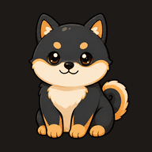
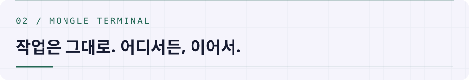
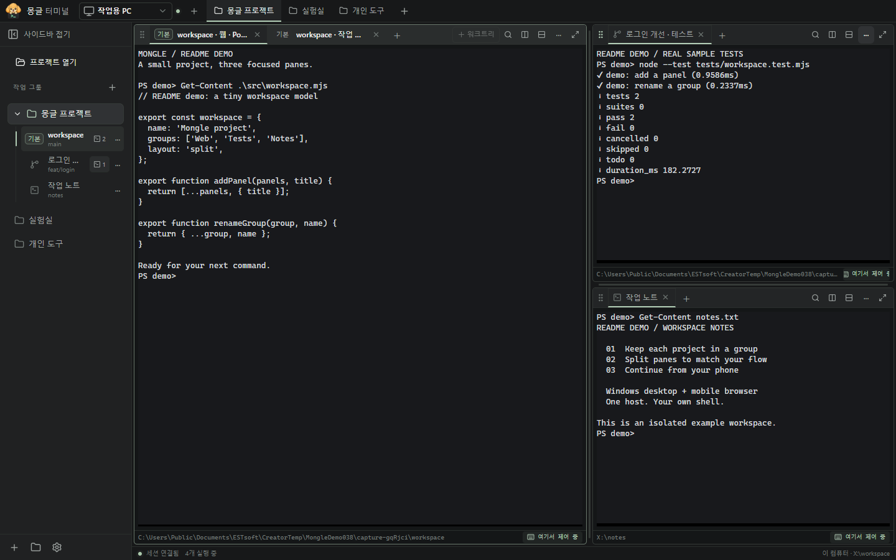
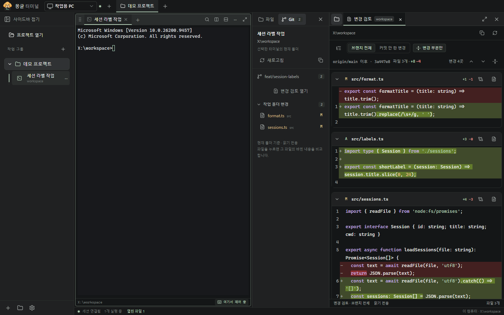

<picture>
  <source media="(max-width: 600px)" srcset="assets/workshop-mobile.png" />
  
</picture>

<picture>
  <source media="(max-width: 600px) and (prefers-color-scheme: dark)" srcset="assets/workshop-signal-dark-mobile.svg" />
  <source media="(max-width: 600px)" srcset="assets/workshop-signal-light-mobile.svg" />
  <source media="(prefers-color-scheme: dark)" srcset="assets/workshop-signal-dark.svg" />
  
</picture>

<h3 align="center">손은 두 개. 하고 싶은 건 조금 많습니다.</h3>

AI에게 코딩을 맡겼는데, 자꾸 터미널을 들여다보게 됩니다. 끝났나? 답을 기다리나? 이번 주 한도는 얼마나 남았지?

제가 만들고 싶은 건 그런 순간에 손이 가는 도구입니다. **일하는 AI 옆에 작은 동료를 놓고, 흩어진 작업에는 편한 자리를 만들어 주는 것.** 귀여움도, 쓸모도 놓치고 싶지 않아서요.

  
  
  

 

## 몽글

<picture>
  <source media="(max-width: 600px) and (prefers-color-scheme: dark)" srcset="assets/mongle-dark-mobile.svg" />
  <source media="(max-width: 600px)" srcset="assets/mongle-light-mobile.svg" />
  <source media="(prefers-color-scheme: dark)" srcset="assets/mongle-dark.svg" />
  
</picture>

**Claude Code·Codex 같은 AI 코딩 도구의 작업 상태에 반응하는 Windows 데스크톱 펫입니다.** 화면 한쪽에서 같이 고민하고, 같이 일하고, 작업이 끝나면 프로젝트 이름이 담긴 말풍선으로 알려 줍니다.

### “끝났나?”를 열 번 묻는 대신.

AI가 생각하면 몽글도 생각 구름을 띄웁니다. 코드를 실행하면 노트북을 펴고 타닥타닥. 일을 마치면 폴짝 뛰며 **“다 했어요!”** 하고 알려 줍니다. 질문이나 권한 확인이 필요할 때는 별도의 알림 카드가 뜹니다.

  
  
   일할 땐 타닥타닥 → 끝나면 폴짝. 실제 앱의 캐릭터 애니메이션입니다.

AI가 서브에이전트에게 일을 나누면, 옆에 **꼬마 분신들이 나타나 함께 일합니다.** 여러 프로젝트를 동시에 실행해도 완료 알림이 세션별로 쌓여, 무엇이 끝났는지 구분할 수 있어요.

### 이번 주 Codex, 얼마나 남았지?

몽글의 **사용량 위젯은 Codex·Claude 계정의 이용 한도**를 보여 줍니다. 계정에서 제공하는 **5시간 단위 한도와 주간 한도를 얼마나 썼는지, 얼마나 남았는지, 언제 초기화되는지**를 바탕화면에서 확인할 수 있습니다. 한도가 초기화되면 알림도 남겨 줍니다.

<picture>
  <source media="(max-width: 600px) and (prefers-color-scheme: dark)" srcset="assets/quota-story-dark-mobile.svg" />
  <source media="(max-width: 600px)" srcset="assets/quota-story-light-mobile.svg" />
  <source media="(prefers-color-scheme: dark)" srcset="assets/quota-story-dark.svg" />
  
</picture>

설치·로그인한 도구의 한도를 공식 사용량 API로 조회하며, OpenCodex의 여러 계정도 계정별로 구분합니다. 위젯은 원하는 위치로 옮길 수 있고, **캐릭터를 숨긴 채 사용량만 띄워 둘 수도 있습니다.**

### 귀여운 얼굴 뒤에는, 꽤 꼼꼼한 작업 기록.

**최근 활동**을 열면 프로젝트별로 어떤 AI가 일하는지, 어떤 모델을 쓰는지, 얼마나 걸렸는지 모아 볼 수 있습니다. 서브에이전트는 부모 작업 아래에 묶이고, 완료된 작업에는 확인 가능한 입력·출력·캐시 토큰도 표시됩니다. 여러 창을 돌릴 때 “이건 어디서 하던 일이더라?”를 줄여 주는 작은 관제실입니다.

<b>AI가 쉬는 동안에도, 몽글은 몽글합니다.</b>

클릭하면 갸웃, 끌어 올리면 대롱대롱. 커서를 눈으로 따라가고, 조용해지면 잠도 잡니다. AI 코딩 도구 없이 캐릭터만 데려와도 괜찮아요.

  
  

보영·호랑·룽지·초코·깍지 중 마음에 드는 동료를 고르세요. 캐릭터 크기와 위치도 조절할 수 있습니다.

  
  

<b>연동·PC 상태·개인정보도 조금 더 알아보기</b>

- **에이전트 연동:** Claude Code·Codex·GJC·OMO의 로컬 세션 활동을 감지합니다. 연동은 각각 끌 수 있습니다.
- **내 PC 카드:** 전체 메모리와 최근 CPU 사용 흐름을 별도 카드로 표시합니다. AI 계정의 이용 한도를 보여 주는 사용량 위젯과는 별개입니다.
- **활동 세부 정보:** 모델의 추론 수준과 실행 시간을 확인하고, OMO·GJC는 확인 가능한 비용도 표시합니다.
- **개인정보:** 에이전트 감지는 로컬 세션 로그를 읽는 방식이며, 몽글 자체 서버로 세션·파일·키 입력 내용을 보내지 않습니다. 사용량 조회와 업데이트에는 네트워크를 사용합니다.

  
  

Windows 10·11 베타 · [변경 이력](https://github.com/bokjk/mongle-releases/releases) · [버그·아이디어 보내기](https://github.com/bokjk/mongle-releases/issues)

 

<picture>
  <source media="(max-width: 600px) and (prefers-color-scheme: dark)" srcset="assets/workbench-bridge-dark-mobile.svg" />
  <source media="(max-width: 600px)" srcset="assets/workbench-bridge-light-mobile.svg" />
  <source media="(prefers-color-scheme: dark)" srcset="assets/workbench-bridge-dark.svg" />
  
</picture>

## 몽글 터미널

<picture>
  <source media="(max-width: 600px) and (prefers-color-scheme: dark)" srcset="assets/terminal-dark-mobile.svg" />
  <source media="(max-width: 600px)" srcset="assets/terminal-light-mobile.svg" />
  <source media="(prefers-color-scheme: dark)" srcset="assets/terminal-dark.svg" />
  
</picture>

프런트엔드 개발 서버 하나, 백엔드 로그 하나, Claude Code 하나, Codex 하나. 분명 방금 보던 창인데 또 어디 갔죠?

**몽글 터미널은 여러 프로젝트의 터미널을 모아 쓰는 Windows용 작업 공간입니다.** 탭과 화면을 나누고, AI가 수정한 파일을 확인하고, 자리를 옮기면 휴대폰 브라우저에서 같은 터미널에 연결합니다.

<picture>
  <source media="(max-width: 600px)" srcset="assets/mongle-terminal-mobile.png" />
  
</picture>

공개 예제 화면입니다. 데스크톱은 0.3.8, 모바일은 휴대폰 너비의 브라우저 데모입니다.

### 창 찾기보다, 코드 보기.

서로 다른 폴더의 터미널도 **작업 그룹 하나에 모으고**, 이름을 붙여 찾습니다. 탭을 가장자리로 끌면 화면이 나뉘고, 다시 합치거나 위치를 바꿔도 실행 중인 작업은 유지됩니다. 왼쪽엔 AI, 오른쪽엔 개발 서버처럼 원하는 작업대를 만들 수 있어요.

같은 저장소에서 기능 개발과 버그 수정을 함께 한다면 **워크트리**를 만드세요. 각 브랜치를 별도 폴더에서 다루는 Git 기능입니다. 터미널에서 바로 만들고, 작업별 터미널을 오가며 진행할 수 있습니다.

### “고쳤어요!” 다음에는, 무엇이 바뀌었는지.

AI의 답변을 읽었으면 코드도 봐야죠. **파일 탐색기는 선택한 터미널의 현재 폴더를 따라가고, Git 목록에서는 바뀐 파일과 수정 전후를 비교**할 수 있습니다. 변경 검토를 열면 여러 파일의 변경을 한 번에 이어 봅니다.

예제 저장소를 사용한 실제 앱 화면입니다. Git 비교는 읽기 전용이며, 커밋·스테이징은 터미널에서 진행합니다.

터미널에 나온 파일 경로를 `Ctrl+클릭`하면 편집 탭으로 열 수 있습니다. 작은 텍스트 파일 수정, 마크다운 미리보기, PDF 읽기도 같은 작업 공간에서 이어집니다.

### AI는 PC에서 일하고, 나는 잠깐 자리 이동.

작업 PC와 휴대폰에서 **Tailscale**을 켜고, QR코드로 접속해 첫 연결을 승인하면 준비 끝. 휴대폰 브라우저에서 **PC에 켜 둔 터미널의 출력을 읽고, 터미널을 바꾸고, 직접 입력**할 수 있습니다. 다른 몽글 PC로 전환하거나 휴대폰 사진을 작업 폴더에 첨부하는 것도 가능합니다.

<picture>
  <source media="(max-width: 600px) and (prefers-color-scheme: dark)" srcset="assets/terminal-flow-dark-mobile.svg" />
  <source media="(max-width: 600px)" srcset="assets/terminal-flow-light-mobile.svg" />
  <source media="(prefers-color-scheme: dark)" srcset="assets/terminal-flow-dark.svg" />
  
</picture>

**“AI가 나를 기다리느라 쉬고 있었네…” 하는 순간도 줄여 줍니다.** 연동한 Claude·Codex의 작업 중·확인 요청·응답 완료를 구분해 표시합니다. 휴대폰 알림을 켜 두면 PC가 잠겼거나 5분 이상 입력이 없을 때 확인·응답 요청을 받을 수 있습니다. 어느 기기에서든 해당 PC의 터미널 화면을 보고 있다면 알림은 보내지 않습니다.

<b>처음 시작할 때, 이것만 알면 됩니다.</b>

1. **Windows 11 x64 설치 파일**을 받고, 새 터미널에서 셸과 시작 폴더를 고릅니다. PowerShell·명령 프롬프트와 설치된 Git Bash·WSL을 사용할 수 있습니다.
2. **Claude Code·Codex는 평소처럼 실행합니다.** 작업 상태 연동은 Windows 네이티브 Claude 2.1.292 이상, PowerShell에서 실행한 Codex CLI 0.162.0 이상을 대상으로 합니다. Codex의 첫 실행에서는 몽글 훅을 검토·신뢰해야 합니다.
3. **휴대폰 연결은 선택입니다.** PC에서만 쓸 때는 원격 연결을 설정하지 않아도 됩니다. 원격으로 쓰려면 Tailscale과 켜져 있는 작업 PC가 필요하며, 한 번에 한 기기가 입력을 제어합니다.
4. **창의 X는 작업 종료가 아닙니다.** 창을 닫거나 ‘앱 종료 · 터미널 유지’를 선택하면 셸은 계속 실행됩니다. 완전 종료·PC 재부팅은 셸을 종료하며, 이후 그룹·배치를 복원해 새 셸을 엽니다. 연동으로 확인한 Claude·Codex 대화는 다시 열지만, 진행 중이던 명령을 자동 재실행하지는 않습니다.

[파일 편집·원격 연결·알림의 자세한 사용 조건](https://github.com/bokjk/mongle-terminal/blob/dev/docs/USER-GUIDE.md)

  
  

Windows 11 x64 미리보기 · [소스 살펴보기](https://github.com/bokjk/mongle-terminal) · [버그·아이디어 보내기](https://github.com/bokjk/mongle-terminal/issues)

 

## 개발 기록

<picture>
  <source media="(max-width: 600px) and (prefers-color-scheme: dark)" srcset="assets/lab-dark-mobile.svg" />
  <source media="(max-width: 600px)" srcset="assets/lab-light-mobile.svg" />
  <source media="(prefers-color-scheme: dark)" srcset="assets/lab-dark.svg" />
  
</picture>

거창한 것보다 <strong>“이거, 내일도 켜 놓고 싶다”</strong>는 도구를 만들고 싶습니다. 작은 불편을 발견하면 고치고, 써 보며 또 고칩니다. 몽글은 옆에서 낮잠을 잘 때도 있지만요.

### 작업대 위의 기술

  
  
  
  
  
  
  

### 함께 쓰고 탐구하는 도구

[ai-token-monitor](https://github.com/bokjk/ai-token-monitor) · [gajae-code](https://github.com/bokjk/gajae-code) · [opencodex](https://github.com/bokjk/opencodex) · [orca](https://github.com/bokjk/orca) · [ouroboros](https://github.com/bokjk/ouroboros)

### 꾸준히 만드는 중

  
  

<picture>
  <source media="(prefers-color-scheme: dark)" srcset="https://raw.githubusercontent.com/bokjk/bokjk/output/github-contribution-grid-snake-dark.svg" />
  
</picture>

   
  <b>여기까지 구경했으면, 우리 꽤 친해진 거죠?</b> 
  마음에 드는 도구가 있다면 써 보세요. 불편한 점이나 아이디어는 각 저장소의 이슈로 남겨 주세요.

  
  

<a href="#">작업실 맨 위로 ↑</a>

